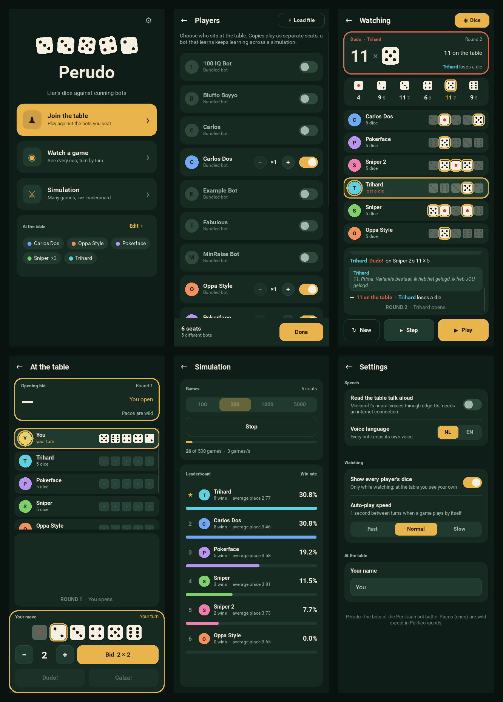

# Perudo for Android

A touch interface over the engine and the bots of this repository, built with
[Kivy](https://kivy.org) and packaged with [Buildozer](https://buildozer.readthedocs.io).
Everything outside Python that the build needs comes from Nix.

What it does:

- **Home**: start a game at the table, watch one, or run a simulation; the
  bots currently seated are listed underneath.
- **Players**: every bot of this repository is included and seated by
  default (as in the bot battle, a bot with `count = 0` starts unseated).
  Switch each on or off and set its copies; the table is remembered. *Load
  file* imports any single-file bot (same API as the example bot) by copying
  it into the app's bots folder, so it is there again after a restart; Remove
  deletes that copy. On Android the folder is
  `Android/data/org.perlikaan.perudo/files/bots`, reachable over USB: `.py`
  files copied in there by hand are picked up as well.
- **Watch a game**: plays by itself (Play / Pause, or Step one turn at a
  time). The card on top shows the current bid, who made it and who is
  thinking. The *Dice* switch shows every player's dice, with the total per
  face (Pacos counted, naturals in small print) and the dice that count for
  the bid ringed in gold. When someone calls Dudo or Calza the cups come up:
  the counted dice stay lit, the rest fade, and the card says how many were
  on the table and who loses a die. The feed below tells the game as it
  happens, with the bots' table talk in speech bubbles.
- **Join the table**: you take a seat. Only your own dice are shown until a
  reveal. Tap a die for the face, set the quantity (the lowest legal bid is
  preselected), and bid, or call Dudo or Calza when they are legal.
- **Simulation**: 100 to 5000 games with the same bot instances (so learning
  bots keep learning), with a live leaderboard: win rate, wins, average place
  and bars scaled to the leader, re-ranked as the games come in.
- **Settings**: text to speech with edge-tts (Microsoft's online neural
  voices, needs internet; every bot keeps its own voice), the voice language,
  whether dice are shown when watching, the auto-play speed and your name.

The Android back button goes back a screen (and leaves a game). The look is
one dark felt table with ivory dice, drawn on the canvas
(`perudo_app/widgets.py`, colours in `perudo_app/theme.py`); the icon and
launch screen in `assets/` come from `tools/make_icons.py`.



## Try it on the desktop

```sh
cd app
uv run python main.py
```

`app/` is its own [uv](https://docs.astral.sh/uv/) project: `pyproject.toml`
and `uv.lock` pin Kivy, edge-tts, Buildozer and Cython, and `uv run` creates
`app/.venv` on first use. The engine is imported from the repository next to
this folder.

## Build the APK

```sh
cd app
nix develop            # Android SDK, NDK, JDK, build tools; runs uv sync
./build.sh             # copies ../perudo in, runs: uv run buildozer android debug
```

The APK lands in `app/bin/`. `./build.sh release` builds a release APK.
`flake.nix` pins the SDK platform (35), build tools (35.0.0), NDK
(25.2.9519653) and Apache Ant and exports them as `ANDROIDSDK`, `ANDROIDNDK`
and `ANT_HOME`, which `build.sh` passes to Buildozer with
`android.skip_update = True`, so Buildozer never downloads tools of its own
(it gets a symlink view of the SDK under `app/.buildozer/android-sdk`, because
it expects sdkmanager under `tools/bin` where the SDK keeps it under
`cmdline-tools`). Nix provides nothing on the Python side: the shell
runs `uv sync`, so Buildozer and Cython come from `uv.lock`. The first build
still fetches python-for-android and the Python packages it compiles for the
phone, and takes a while.

`p4a-recipes/` holds recipes overriding python-for-android's: aiohttp is
installed as pure Python from a current release, because the bundled recipe's
3.8.3 does not compile against Python 3.14 (`build.sh` makes aiohttp's
helpers pure Python the same way).

## Build on GitHub Actions

`.github/workflows/android.yml` runs the same build on every push that
touches `app/` or `perudo/` (and on demand from the Actions tab): it installs
Nix, enters the flake's shell and runs `./build.sh`, caching the
python-for-android build between runs. The APK is attached to the run as the
artifact **perudo-apk**: open the run on the Actions tab and download it
from the Artifacts section at the bottom.

## Restricted networks

The build fetches from four kinds of hosts: PyPI (Buildozer, Cython, the
pure-Python packages), GitHub (python-for-android itself, SDL2 and its
libraries as release assets), the upstream source hosts python-for-android
compiles from (python.org, sqlite.org, openssl.org, GitHub source archives),
and dl.google.com (the Android SDK and NDK, fetched by Nix). Where only
the last two are blocked:

```sh
cd app
uv run python tools/seed_sources.py   # ~100 MB from PyPI, GitHub releases, archive.ubuntu.com
nix develop .#prebuilt                # needs ANDROIDSDK and ANDROIDNDK set to an SDK and NDK you have
./build.sh
```

`tools/seed_sources.py` fetches the python-for-android release from PyPI
into `app/.p4a-src` (used through `p4a.source_dir`, so Buildozer never
clones GitHub) and CPython, SQLite, OpenSSL, libffi, Kivy and pyjnius from
PyPI, GitHub release assets and Ubuntu's package pool, repacked under the
file names python-for-android expects in its download cache with the
markers that make it skip the download. Ubuntu carries newer CPython and
SQLite releases than python-for-android pins, so the script writes
`app/.p4a-src/requirements`, the spec's list with `python3`, `hostpython3`
and `sqlite3` pinned to the versions it fetched, which `build.sh` passes to
Buildozer, and reshapes the one CPython file python-for-android patches so
the patch still applies.

`build.sh` passes the SDK, NDK and python-for-android checkout to Buildozer
through the environment (`APP_ANDROID_SDK_PATH`, `APP_ANDROID_NDK_PATH`,
`APP_P4A_SOURCE_DIR`; Buildozer reads any spec key as `SECTION_KEY`), so
`buildozer.spec` holds no machine-specific paths. `P4A_SOURCE_DIR` overrides
the checkout `seed_sources.py` made.

The SDK and NDK are not covered: Google serves them only from dl.google.com,
and Nix, Buildozer and the SDK manager all fetch from there. The `prebuilt`
shell is for an SDK (platform 33 and build tools installed) and an NDK
(25 to 28) from another machine or a container image such as
`saschpe/android-ndk`; `nix develop` (the default shell) is for networks
where dl.google.com is reachable.

## Tests

```sh
cd app && uv run pytest
```

The tests cover the app's model (loading bots, stepping a game with all dice
and totals, the human seat, simulations with live standings, settings) without
Kivy.
